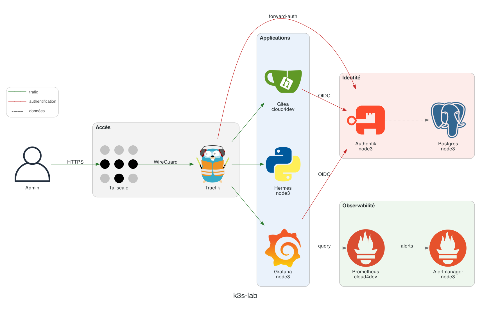
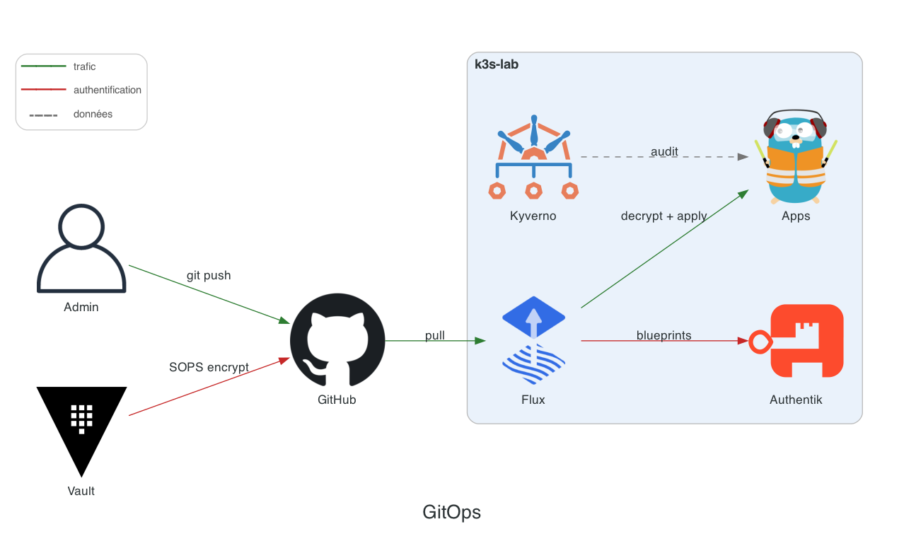

<p align="center">
  
</p>

<h1 align="center">Harness-Cluster</h1>

<p align="center">
  Un petit lab k3s qui fait tourner des harnesses d'agents IA en continu, sur du vieux hardware recyclé, entièrement géré en GitOps avec Flux CD.
</p>

## L'idée

Plutôt que de lancer mes agents à la main, je les fais vivre 24/7 sur trois vieilles machines, et tout l'état du cluster est décrit dans ce repo. Flux synchronise le cluster avec Git : je pousse, ça se déploie. La seule chose appliquée à la main est la config hôte du control-plane (`hosts/`).

## Le cluster

| Nœud | Rôle | Ressources |
|---|---|---|
| **node1** | k3s server (control-plane, datastore SQLite) | 2 vCPU, 4 Go |
| **cloud4dev** | k3s agent | 2 vCPU, 4 Go |
| **node3** | k3s agent, porte la plupart des applis | 8 vCPU, 11 Go, NVMe |

Les trois machines se parlent uniquement par Tailscale (flannel passe sur `tailscale0`). Rien n'est exposé sur Internet.

## Architecture





Les deux schémas sont générés par [`docs/diagrams/lab_diagram.py`](docs/diagrams/), qui lit le placement réel des pods avec `kubectl`.

## Ce qui tourne dessus

Chaque brique a sa propre Flux Kustomization dans `clusters/k3s-lab/`, qui pointe vers un dossier de `apps/`.

| Dossier | Rôle |
|---|---|
| `hermes-agent/` | [Hermes Agent](https://github.com/NousResearch/hermes-agent) : dashboard web, gateway A2A, plugin d'audit (SQLite) avec exporter Prometheus, ticker cron chaque minute |
| `authentik/` | SSO/OIDC (Helm + Postgres), blueprint des groupes `lab-*`, forward-auth Traefik |
| `gitea/` | Forge Git interne, login OIDC via Authentik |
| `monitoring/` | Prometheus, Alertmanager, Grafana (OIDC) et dashboards (cluster, coûts, agent) |
| `kepler/` | Mesure de la consommation énergétique par pod ([Kepler](https://github.com/sustainable-computing-io/kepler)) |
| `kepler-lab/` | Banc de validation de Kepler : charge CPU calibrée, comparaison du RAPL brut avec l'attribution Kepler |
| `kyverno/`, `kyverno-policies/` | Admission : tag d'image obligatoire, limites de ressources, `runAsNonRoot` |
| `tetragon/`, `tetragon-policies/` | Détection runtime eBPF : lecture de fichiers sensibles de l'hôte |
| `cert-manager/`, `cert-manager-issuers/` | CA interne et certificats des ingress `*.k3s-lab.local` |
| `coredns-ha/` | CoreDNS à 2 réplicas répartis sur les nœuds (après un incident de saturation de node1) |
| `backup/` | Sauvegarde du datastore k3s toutes les 12 h, dumps applicatifs chiffrés age chaque nuit |
| `system-upgrade/` | Upgrades k3s par [system-upgrade-controller](https://github.com/rancher/system-upgrade-controller) : server puis agents, un nœud à la fois |

`hosts/node1/` contient le durcissement de l'apiserver, hors Flux : auth OIDC pour `kubectl`, audit log, chiffrement des Secrets au repos.

## Secrets : SOPS + age

Le repo est public, mais les secrets y sont quand même, chiffrés avec [SOPS](https://github.com/getsops/sops) et [age](https://github.com/FiloSottile/age). Seuls les champs `data` et `stringData` sont chiffrés (voir [`.sops.yaml`](.sops.yaml)), la structure reste lisible par Flux et kustomize. Flux les déchiffre au moment de l'apply avec la clé privée du Secret `flux-system/sops-age`, qui n'est jamais commitée.

```bash
sops apps/hermes-agent/secret.sops.yaml   # créer ou modifier un secret
```

Le secret scanning et la push protection de GitHub sont activés sur le repo.

## Accéder aux interfaces

Chaque UI a son nom en `*.k3s-lab.local` derrière Traefik, avec un certificat de la CA interne, et n'est joignable que depuis le tailnet. Tout passe par Authentik, MFA obligatoire (YubiKey chez moi) :

- **Grafana** et **Gitea** : OIDC natif.
- **Hermes**, **Prometheus** et **Alertmanager** : forward-auth Traefik, réservé au groupe `lab-admins`.
- **kubectl** : OIDC sur l'apiserver, droits selon les groupes `oidc:lab-*`.

Les accès machine (A2A, backups, scrapes) restent hors SSO et utilisent des tokens.

## Mettre en route depuis zéro

Il faut un cluster k3s, le CLI Flux, la clé privée age et un token GitHub pour le bootstrap.

```bash
# 1. la clé de déchiffrement SOPS
kubectl create namespace flux-system
kubectl -n flux-system create secret generic sops-age \
  --from-file=age.agekey=/chemin/vers/age.agekey

# 2. Flux
flux bootstrap github \
  --owner=iacker --repository=Harness-Cluster \
  --branch=main --path=clusters/k3s-lab
```

Flux déploie ensuite tout le reste, dans l'ordre des `dependsOn`. Le repo étant public, la synchro elle-même n'a pas besoin d'identifiants (pas de `secretRef` sur le `GitRepository`).

## Au quotidien

```bash
flux get kustomizations                          # état de la synchro
flux reconcile kustomization apps --with-source  # forcer une synchro
```

Les mises à jour de charts et d'images arrivent en PR via [Renovate](renovate.json), le lundi matin, sans automerge.
